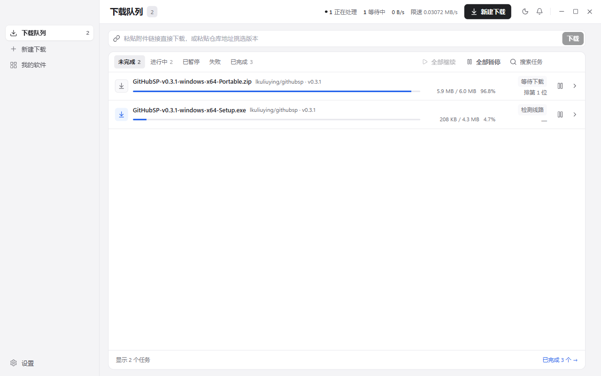

# GitHubSP

[](LICENSE)
[](https://v2.tauri.app/)
[](https://react.dev/)
[](https://www.rust-lang.org/)

面向 Windows 的 GitHub Release 附件下载工具，使用 **Tauri 2 + React + TypeScript + Rust**，提供安装版和免安装版。

[English](#english) · [下载 v0.4.0](https://github.com/lkuliuying/githubsp/releases/tag/v0.4.0) · [问题反馈](https://github.com/lkuliuying/githubsp/issues)

> v0.4.0 重新整理了界面：侧边栏合并为 4 项，首页是带快速下载栏的下载队列，并新增「我的软件」、多连接分段下载、自定义镜像、主题色和界面缩放。更新内容见 [v0.4.0 发布说明](docs/releases/v0.4.0.md)；上一版见 [v0.3.1 发布说明](docs/releases/v0.3.1.md)。

v0.4.0 包含按[功能迭代方案](docs/design/2026-11-08-feature-expansion-plan.md)完成的 M0–M4：附件偏好与代理设置、[Harness 原生插件及 MCP](docs/agent-integration.md)、更新中心、软件文件库和关注清单迁移。开发期间的本地阶段记录（当时编号为 v0.3.2–v0.7.0，均未发布）保存在 [docs/milestones](docs/milestones/README.md)。

界面重构的页面对照、各轮试用反馈和验证范围见[界面重构说明](docs/design/2026-11-18-software-centric-ui.md)。

原生插件已独立迭代到 v0.7.2，参考 DSH-better-sidebar，直接通过 Harness 原生「设置 → GitHubSP」显示数据目录设置，适配当前 0.2.2-rc.1。插件源码与验证边界见[独立仓库](https://github.com/lkuliuying/dsh-githubsp)和[接入说明](docs/agent-integration.md)。

| 版本 | 当前源码版本 | 后续开发与维护 |
| --- | --- | --- |
| 桌面版 `GitHubSP` | v0.4.0 | 本仓库 [lkuliuying/githubsp](https://github.com/lkuliuying/githubsp)；维护 Tauri、Rust 核心和本机 Agent 服务 |
| DSH 插件版 `dsh-githubsp` | v0.7.2 | 独立仓库 [lkuliuying/dsh-githubsp](https://github.com/lkuliuying/dsh-githubsp)；维护插件设置、工具、MCP、Skill 和插件打包 |

两端独立迭代版本号。`integrations/agent-tools` 仅保留拆分时快照，插件后续修改在独立仓库完成；插件仍需配套桌面进程，不能独立下载。桌面 v0.4.0 没有改动本机 Agent 接口，插件 v0.7.2 可继续使用。



## 功能

| 模块 | 功能 |
| --- | --- |
| 我的软件 | 每个项目显示本地版本、最新版本和文件状态，有新版本时一键「更新到 vX」，多个更新可「全部更新」；下载过但未关注的项目可一键关注。详情面板含更新说明、版本记录和本地文件；「更新动态」标签按时间列出新版本，支持标为已读、忽略此版本、分组和标签；关注清单可导入导出 |
| 下载队列 | 首页。顶部快速下载栏：粘贴附件链接直接加入队列，粘贴仓库地址转到新建下载并读取版本。串行下载、暂停恢复、任务详情、换线确认；失败原因直接显示在任务行并可重试。「已完成」标签提供分页、搜索、文件位置和重新下载 |
| 新建下载 | 一个输入框自动识别仓库/Release 页面地址或附件链接（每批最多 100 个）；预览时显示每个文件的大小，链接失效会直接标出；版本与附件选择、目录检查、重复项识别与下载前确认 |
| 设置 | 左侧分类：通用（外观、主题色、界面缩放）、下载、网络（代理、镜像与线路检测）、关注更新、Agent 接入、数据与备份、关于；普通设置改完即保存，支持跨分类搜索 |
| Agent 接入 | DeepSeek Harness 原生插件优先验证，随后开放同一组 13 个 MCP 工具；共享队列、幂等请求及受限目录 |

界面支持浅色、深色和跟随系统，主题色可选蓝色（默认）、青绿、紫色、石墨，并支持界面缩放和减少动态。切换模块保留本次运行中的输入、筛选、选择、滚动位置及未保存设置。可查看[我的软件](docs/images/software.png)和[设置 → 网络](docs/images/settings.png)的预览。预览截图来自隔离测试数据和真实公开 Release。

支持公开 GitHub 仓库、Release 页面和标准附件链接：

```text
https://github.com/{owner}/{repo}
https://github.com/{owner}/{repo}/releases/tag/{tag}
https://github.com/{owner}/{repo}/releases/download/{tag}/{filename}
https://github.com/{owner}/{repo}/releases/latest/download/{filename}
```

新建下载可以一次粘贴多个附件链接，每批最多 100 项。平台和架构提示来自文件名，下载前仍需确认；候选支持保存项目的平台、架构及安装版/便携版偏好，无法确认或多个命中时手动选择。大于 2 MB 的文件默认用 4 个连接分段下载，可在设置里改为 1–8 个。网络设置支持直连、系统代理及无账号密码的 HTTP/HTTPS 代理，并可添加最多 8 个自定义 HTTPS 镜像，与内置线路一起测速；这些设置保存并重启后生效。暂不支持私有仓库、Git clone 和 GitHub 自动生成的源码包；作为 Release 附件上传的源码压缩包可以下载。程序不会自动执行下载的文件或安装应用更新。

## Windows 使用与分发

要求 Windows 10/11 x64。安装版和轻量免安装版均使用 Microsoft Edge WebView2 Runtime，用户无需安装 Node.js、pnpm 或 Rust。

| 文件 | 使用方式 |
| --- | --- |
| [GitHubSP-v0.4.0-windows-x64-Setup.exe](https://github.com/lkuliuying/githubsp/releases/download/v0.4.0/GitHubSP-v0.4.0-windows-x64-Setup.exe) | 当前用户安装；缺失 WebView2 时下载并安装 Evergreen Runtime。 |
| [GitHubSP-v0.4.0-windows-x64-Portable.zip](https://github.com/lkuliuying/githubsp/releases/download/v0.4.0/GitHubSP-v0.4.0-windows-x64-Portable.zip) | 解压完整目录后运行 `GitHubSP.exe`；需要系统已有 WebView2。 |
| `SHA256SUMS.txt` | 对照文件名校验安装包和 ZIP 的 SHA-256。 |

试用前退出旧版。普通免安装模式默认仍使用 `%LOCALAPPDATA%\com.githubsp.desktop`，并遵循已保存的数据位置；免安装不等于数据随程序移动。需要随身数据时，可在 exe 旁创建空文件 `portable-mode.flag`；独立测试可使用 `--data-dir <绝对路径>`。具体规则、备份及恢复见 [数据与存储](docs/data-storage.md)。

```powershell
Get-FileHash .\GitHubSP-v0.4.0-windows-x64-Portable.zip -Algorithm SHA256
Get-Content .\SHA256SUMS.txt
.\GitHubSP.exe --data-dir "F:\GitHubSP-试用"
```

## 开发

要求 Rust 1.96+、Node.js、pnpm 10、PowerShell 7、Visual Studio C++ Build Tools 和 WebView2 Runtime。

```powershell
pnpm --dir desktop install --frozen-lockfile --ignore-scripts
cargo fetch --locked --target x86_64-pc-windows-msvc
node desktop/scripts/notices.mjs --rust
pnpm --dir desktop desktop
```

许可证生成会读取 Cargo 缓存，首次开发先执行 `cargo fetch`。源代码、应用标识、IPC、数据库与下载核心的边界见 [桌面架构与构建](docs/tauri-desktop.md)。

```powershell
pnpm --dir desktop test
pnpm --dir desktop build
cargo test -p githubsp-core -p githubsp-desktop --locked --offline
cargo clippy -p githubsp-desktop --all-targets --locked --offline -- -D warnings
cargo fmt --all -- --check
./scripts/verify-desktop.ps1 -Offline -OutputDirectory artifacts/verification/local-check
```

生成安装版、免安装版、依赖许可证和校验和：

```powershell
./scripts/package-desktop-windows.ps1 -Offline -OutputDirectory artifacts/build/tauri-candidate
```

再次打包请使用新的输出目录。`-Offline` 仅限制 Cargo 依赖访问，不代表缺失 WebView2 的机器可以完全离线安装。打包脚本不发布、不签名；固定版本 WebView2 的可选打包方式见 [分发说明](docs/tauri-desktop.md#两种-windows-分发)。

插件开发、测试及分发请使用 [dsh-githubsp 独立仓库的说明](https://github.com/lkuliuying/dsh-githubsp#开发与打包)，桌面工程中的旧插件打包脚本仅用于复现拆分时快照。

## 项目结构

```text
core/                 下载、网络、SQLite、收藏、备份与迁移（Rust 库）
desktop/              React 前端与 Tauri 宿主
integrations/         插件拆分时快照；后续在 dsh-githubsp 仓库维护
scripts/              验证、打包与桌面/Agent 验收脚本
docs/                 架构、数据与 Agent 接入说明
  releases/           各版本发布说明
  design/             功能迭代与界面重构方案
  milestones/         v0.4.0 发布前的本地阶段记录
  images/             README 预览截图
artifacts/            本地交付包、参考源码和验证记录（不提交）
```

默认 Cargo 入口为 `githubsp-desktop`。旧版 Slint 实现（`native-desktop/`、`automation/` 及其脚本和工作流）已从仓库移除，需要时可从 [v0.3.0 标签](https://github.com/lkuliuying/githubsp/tree/v0.3.0) 或 Git 历史查看；v0.3.0 发布范围见 [v0.3.0 发布说明](docs/releases/v0.3.0.md)。

## 验证与限制

v0.4.0 发布前回归通过 142 项核心、9 项 Tauri 宿主和 8 项前端测试，以及生产构建、Clippy 和格式检查；各轮界面改动都用隔离数据在真实桌面程序中截图核对。`verify-desktop-ui.cjs` 等完整桌面验收脚本已按新界面调整，但未在发布前重跑，见[界面重构说明](docs/design/2026-11-18-software-centric-ui.md#验证)。M0–M4 阶段另通过 3 项插件测试。实际 WebView2/IPC、已安装 Harness 运行时、Codex MCP 控制接口和 Claude Code MCP 回合分别保留证据；公开附件的暂停、桌面重启、续传和官方 SHA-256 对照通过。最终包的复验和未通过项见 [交付说明](docs/milestones/local-v0.7.0.md)。模拟 IPC 检查仍不代表完整桌面验收。

- 公共加速服务和自定义镜像会收到公开附件 URL；短时探测不保证整文件持续速度。网速低于约 50 KB/s 时，测速用已收到的部分数据估算。
- GitHub 未认证 API 可能限流；没有官方校验摘要时，不能据此确认文件来源的真实性。
- 下载与数据库记录沿用现有兼容协议；备份应用记录不会移动下载成品或续传分片。
- 限速保持按 KiB/s 存储，候选的设置和队列统一按十进制 MB/s 显示，旧数据兼容。
- 干净系统安装/卸载、缺失 WebView2、多 DPI/多显示器及固定运行时离线包仍未验收。
- Harness 自然语言选工具质量未调用真实模型验证；Claude 插件 Skill 的额外模型工作流遇到当前服务超时。实际运行时/协议通过与这些未通过项分别记录。

Tauri CI（`.github/workflows/desktop.yml`）覆盖当前入口，只验证不发布；Release 发布须显式手动执行。当前没有独立项目记忆文件，长期约定以本 README 及 `docs/` 中的现行说明为准。

## 许可与来源

GitHubSP 自有代码使用 [MIT 许可](LICENSE)。页面骨架与动效改编自固定提交的 magpie，基础控件参考 cc-switch，进度组件参考 Motrix；各自版权、完整 MIT 文本和改编范围见 [第三方声明](desktop/THIRD_PARTY_NOTICES.md)。安装版与免安装版均随附运行依赖许可。

## English

GitHubSP is a Windows GitHub Release asset downloader built with **Tauri 2, React, TypeScript and Rust**. Its home page is the download queue with a quick-download bar for pasted links. "My Software" lists each project with the downloaded and latest versions and offers one-click updates. It also provides pause/resume, completed history, a single smart input for repository pages or asset links, route diagnostics under network settings, and searchable settings.

The current Tauri source produces an NSIS installer and a portable ZIP. Both use WebView2; the installer can download the runtime when missing, while the lightweight ZIP needs an existing runtime. Version v0.4.0 publishes both formats on GitHub Releases. Historical v0.3.0 assets use Slint.

Exit older versions before running a build. Portable normally shares the configured application data directory; `portable-mode.flag` beside the executable selects a local `data/` directory, and `--data-dir <absolute path>` selects isolated test data. Private repositories, Git clone, auto-generated source archives and automatic installation are not supported.

Development and build commands are shown above. `core/` owns downloads and storage, and `desktop/` is the current application. The legacy Slint implementation was removed from the repository and remains available under the `v0.3.0` tag. Local tests and simulated UI checks do not establish clean-system installation or real-network acceptance. Project and third-party license notices are included with both distribution formats.
