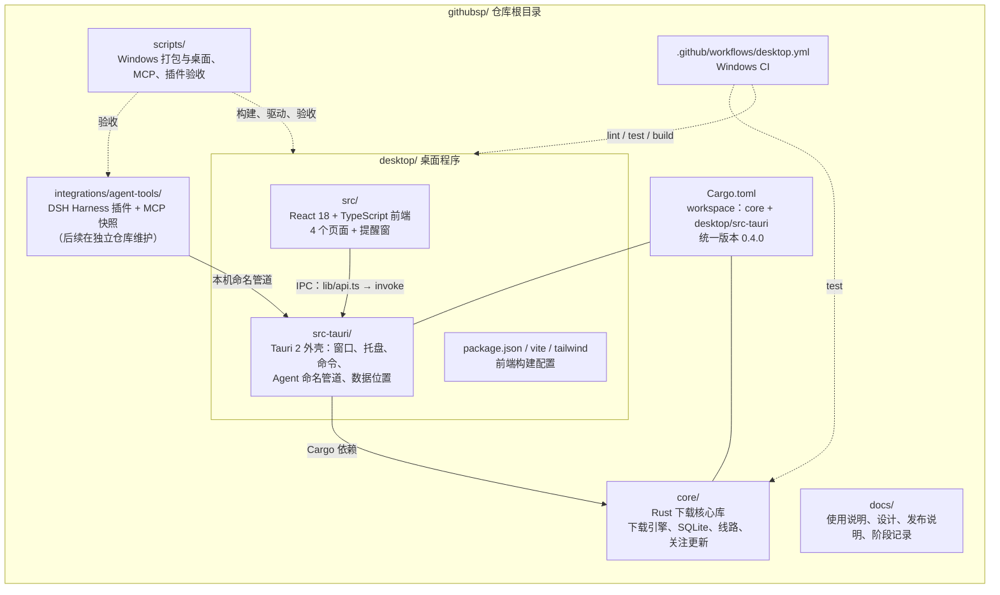
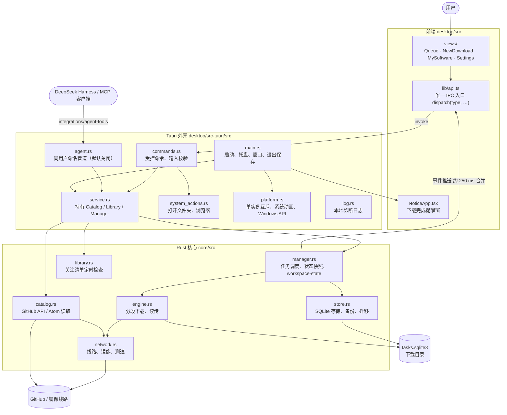
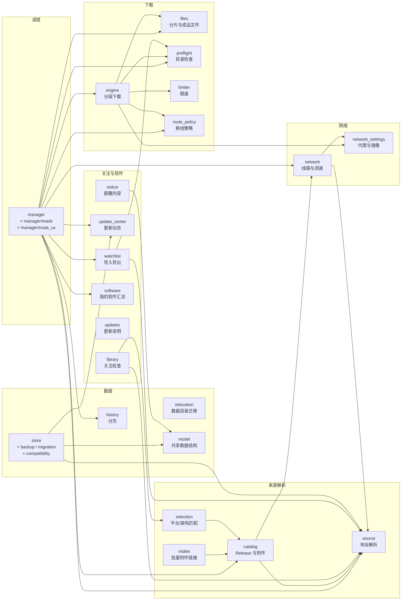
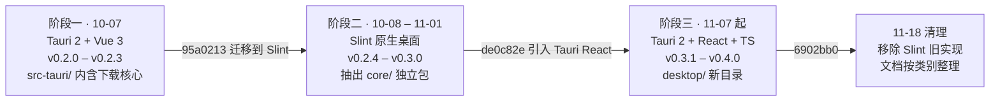
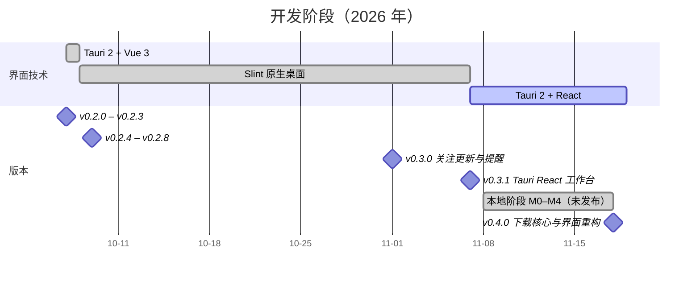
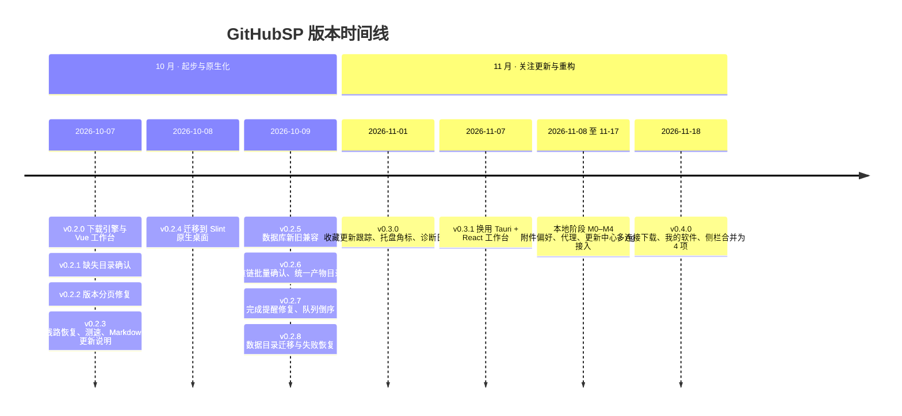

# 项目架构与开发历史

本文按 2026-11-19 的 `main`（`6902bb0`，源码版本 v0.4.0）整理，覆盖仓库里纳入 Git 的全部文件（本文加入前共 166 个），以及从 2026-10-07 第一个提交到现在的 36 个提交、12 个版本标签。

- [一、整体架构](#一整体架构)
- [二、运行时分层](#二运行时分层)
- [三、Rust 核心模块依赖](#三rust-核心模块依赖)
- [四、全目录与文件](#四全目录与文件)
- [五、开发历史](#五开发历史)

## 一、整体架构

仓库是一个 Cargo workspace，有两个 Rust 包：`core`（下载核心库 `githubsp-core`）和 `desktop/src-tauri`（Tauri 桌面程序 `githubsp-desktop`，默认构建目标）。前端 React 代码在 `desktop/src`，`integrations/agent-tools` 是 DSH 插件拆分到独立仓库前的快照，`scripts` 放打包和验收脚本。



| 目录 | 语言与框架 | 职责 |
| --- | --- | --- |
| `core/` | Rust、tokio、reqwest、rusqlite | 解析 GitHub 地址、读取 Release、选线测速、分段下载、续传、SQLite 存储与迁移、关注更新、软件库 |
| `desktop/src-tauri/` | Rust、Tauri 2.12 | 窗口与托盘、受控命令、状态推送、退出保存、数据目录、单实例、本机 Agent 服务 |
| `desktop/src/` | React 18、TypeScript、Tailwind、Vite | 下载队列、新建下载、我的软件、设置四个页面和独立提醒窗 |
| `integrations/agent-tools/` | Node.js（ESM） | Harness 原生插件、MCP 服务、13 个工具、Skill；拆分时快照 |
| `scripts/` | PowerShell、Node.js（CJS） | 打包安装版/免安装版、驱动真实桌面窗口做验收、验证 MCP 和插件 |
| `docs/` | Markdown | 本文和其他文档 |

本地还有两个不进 Git 的目录：`target/`（Cargo 编译产物）和 `artifacts/`（打包产物、参考源码等本地文件），已在 `.gitignore` 中忽略。

## 二、运行时分层

一次用户操作从界面到磁盘、网络的路径如下。前端只通过 `desktop/src/lib/api.ts` 调用后端；Agent 插件走另一条入口，但和界面共用同一套 Service。



## 三、Rust 核心模块依赖

依据各文件里的 `use crate::…` 整理。`manager.rs` 是调度中心，引用的模块最多；`error.rs` 和 `model.rs` 被大部分模块共用，为了图面清楚只画出主要依赖。



## 四、全目录与文件

下面是 Git 跟踪的全部文件（不含 `target/`、`artifacts/`）。行数为 2026-11-19 统计，用来大致说明体量。

```text
githubsp/
├── .github/
│   └── workflows/
│       └── desktop.yml                 # Windows CI：pnpm、Rust 1.96.1、fmt/clippy、测试、构建
├── .gitignore
├── Cargo.toml                          # workspace：core + desktop/src-tauri，统一版本 0.4.0
├── Cargo.lock
├── LICENSE                             # MIT
├── README.md                           # 中英双语说明
│
├── core/                               # ── Rust 下载核心库 githubsp-core（lib 名 githubsp_lib）
│   ├── Cargo.toml
│   ├── build.rs
│   ├── examples/                       # 手动运行的验证与基准程序
│   │   ├── benchmark_routes.rs         # 线路测速基准
│   │   ├── history_scaling.rs          # 大量历史记录分页性能
│   │   ├── verify_download.rs          # 真实下载校验
│   │   └── verify_v2.rs                # v2 下载流程校验
│   └── src/
│       ├── lib.rs                      # 模块出口
│       ├── error.rs                    # 统一错误类型
│       ├── model.rs                    # 任务、设置、收藏等共享数据结构（552 行）
│       ├── manager.rs                  # 任务调度中心、状态快照（2381 行，全仓最大）
│       ├── manager/
│       │   ├── reads.rs                # 只读查询
│       │   └── route_ux.rs             # 换线确认与线路提示
│       ├── source.rs                   # GitHub 仓库 / Release / 附件地址解析
│       ├── intake.rs                   # 批量附件链接收集（每批最多 100）
│       ├── catalog.rs                  # Release 列表、附件大小、Atom 降级
│       ├── selection.rs                # 按平台、架构、安装版/便携版匹配附件
│       ├── engine.rs                   # 下载引擎：多连接分段（默认 4，>2 MiB 才分段）
│       ├── files.rs                    # 分片文件、合并与成品落盘
│       ├── limiter.rs                  # 下载限速
│       ├── preflight.rs                # 下载目录检查、重复项识别
│       ├── route_policy.rs             # 换线与重试策略
│       ├── network.rs                  # 内置线路、自定义镜像、测速
│       ├── network_settings.rs         # 直连 / 系统代理 / HTTP(S) 代理、镜像上限 8
│       ├── history.rs                  # 已完成任务分页
│       ├── library.rs                  # 关注项目定时检查与自动下载目标
│       ├── update_center.rs            # 更新动态：发布游标、已读、忽略、分组标签
│       ├── updates.rs                  # 更新说明 Markdown 与安全链接
│       ├── watchlist.rs                # 关注清单导入导出、冲突预览
│       ├── software.rs                 # 「我的软件」按项目汇总本地版本
│       ├── notice.rs                   # 下载完成提醒内容
│       ├── relocation.rs               # 数据目录迁移事务
│       ├── relocation/
│       │   ├── files.rs                # 迁移文件校验与目录锁
│       │   └── tests.rs
│       ├── store.rs                    # SQLite 读写
│       ├── store/
│       │   ├── backup.rs               # Backup API 备份
│       │   ├── migration.rs            # 结构升级
│       │   ├── compatibility.rs        # 新旧版本数据库互读
│       │   ├── compatibility_tests.rs
│       │   ├── tests.rs
│       │   └── fixtures/               # 旧版数据结构样本，用于兼容测试
│       │       ├── v020/{model.rs, store.rs}
│       │       └── v023/{model.rs, store.rs}
│       ├── tests.rs                    # 下载、续传、换线测试（1944 行）
│       ├── tests_v2.rs
│       ├── diagnostics_tests.rs
│       └── route_experience_tests.rs
│
├── desktop/                            # ── Tauri 2 + React 桌面程序
│   ├── package.json                    # pnpm 脚本：dev / build / test / desktop
│   ├── pnpm-lock.yaml
│   ├── index.html
│   ├── vite.config.ts
│   ├── tailwind.config.ts
│   ├── postcss.config.cjs
│   ├── tsconfig.json
│   ├── THIRD_PARTY_NOTICES.md          # magpie、cc-switch、Motrix 改编说明与许可
│   ├── scripts/
│   │   └── notices.mjs                 # 生成前端 / Rust 依赖许可清单
│   ├── src/                            # React 前端
│   │   ├── main.tsx                    # 入口
│   │   ├── App.tsx                     # 主窗口外壳、侧栏、页面切换
│   │   ├── NoticeApp.tsx               # 独立的下载完成提醒窗
│   │   ├── styles.css                  # 语义色变量、主题色、深浅色
│   │   ├── assets/
│   │   │   ├── app-icon.svg            # 原创应用图标
│   │   │   └── tray-icon.svg
│   │   ├── views/                      # 4 个页面
│   │   │   ├── Queue.tsx               # 下载队列（首页、快速下载栏、已完成）
│   │   │   ├── NewDownload.tsx         # 新建下载
│   │   │   ├── MySoftware.tsx          # 我的软件 + 更新动态
│   │   │   ├── Settings.tsx            # 设置（7 个分类，1251 行）
│   │   │   ├── Routes.tsx              # 线路检测（嵌在设置 → 网络）
│   │   │   └── Updates.tsx             # 更新动态列表
│   │   ├── components/
│   │   │   ├── Navigation.tsx          # 侧栏与弹簧滑块
│   │   │   ├── PageHost.tsx            # 页面保活（hidden + inert）
│   │   │   ├── PageActivity.tsx        # 页面可见状态
│   │   │   ├── TaskProgress.tsx        # 任务进度条
│   │   │   ├── Pager.tsx               # 分页
│   │   │   ├── Menu.tsx                # 「⋯」菜单
│   │   │   ├── AssetPreferenceFields.tsx  # 附件偏好表单
│   │   │   ├── WatchlistTransfer.tsx   # 关注清单导入导出
│   │   │   ├── common.tsx
│   │   │   └── ui/{button, dialog, input}.tsx
│   │   └── lib/
│   │       ├── api.ts                  # 唯一 IPC 入口
│   │       ├── model.ts                # 前端数据类型与格式化
│   │       ├── source.ts               # 输入内容识别（仓库 / 附件链接）
│   │       ├── software.ts             # 我的软件状态推导
│   │       ├── appearance.ts           # 主题、主题色
│   │       ├── zoom.ts                 # 界面缩放
│   │       ├── utils.ts
│   │       └── {api, model, software, source}.test.ts   # Vitest 单元测试
│   └── src-tauri/                      # Tauri 外壳（Rust 包 githubsp-desktop）
│       ├── Cargo.toml
│       ├── build.rs
│       ├── tauri.conf.json             # 窗口、打包、安装器配置
│       ├── capabilities/main.json      # 前端可用权限
│       ├── icons/                      # 32、128、128@2x、ico、托盘图标
│       └── src/
│           ├── main.rs                 # 启动、托盘、窗口、退出保存
│           ├── commands.rs             # 前端调用的受控命令
│           ├── service.rs              # 服务生命周期，持有核心对象
│           ├── agent.rs                # 本机 Agent 命名管道服务
│           ├── platform.rs             # 单实例互斥、Windows 系统接口
│           ├── system_actions.rs       # 打开文件夹、系统浏览器
│           └── log.rs                  # 诊断日志与轮换
│
├── integrations/
│   └── agent-tools/                    # ── DSH 插件 + MCP（拆分时快照，现于 dsh-githubsp 维护）
│       ├── package.json / pnpm-lock.yaml / LICENSE / README.md
│       ├── .claude-plugin/{plugin.json, 512x512.png}
│       ├── .mcp.json
│       ├── cordis.patch.yml
│       ├── harness.mjs                 # Harness 原生插件入口
│       ├── harness-client.js           # Harness 设置页客户端模块
│       ├── mcp.mjs                     # MCP 服务入口
│       ├── client.mjs                  # 连接桌面命名管道
│       ├── tools.mjs                   # 工具注册
│       ├── software-tools.mjs          # 我的软件相关工具
│       ├── update-tools.mjs            # 更新动态相关工具
│       ├── locale/{en, zh}.json
│       ├── skills/githubsp-release-workflows/SKILL.md
│       └── tests/{client, harness, mcp}.test.mjs
│
├── scripts/                            # ── 打包与验收
│   ├── package-desktop-windows.ps1     # 打包安装版、免安装版、SHA256SUMS
│   ├── package-agent-tools.ps1         # 打包插件（旧入口）
│   ├── verify-desktop.ps1              # 桌面一键验收
│   ├── verify-desktop-ui.cjs           # 驱动真实窗口检查界面
│   ├── verify-software.cjs             # 我的软件验收
│   ├── verify-update-center.cjs        # 更新动态验收
│   ├── verify-mcp.cjs                  # MCP 工具验收
│   ├── verify-harness.cjs              # Harness 插件验收
│   ├── verify-agent-package.cjs        # 插件包内容检查
│   └── lib/
│       ├── desktop-driver.cjs          # 桌面窗口驱动
│       ├── harness-driver.cjs / harness-host.cjs
│       ├── claude-mcp-host.cjs / codex-mcp-host.cjs
│       └── claude-plugin-discovery.cjs / claude-plugin-workflow.cjs
│
└── docs/                               # ── 文档
    ├── architecture.md                 # 本文：架构图与开发历史
    ├── tauri-desktop.md                # Tauri 桌面结构、界面约定、开发验证
    ├── data-storage.md                 # 数据位置、兼容性、备份恢复
    ├── agent-integration.md            # 本机 Agent 接口与插件联调记录
    ├── design/
    │   ├── 2026-11-08-feature-expansion-plan.md   # M0–M4 功能迭代方案
    │   └── 2026-11-18-software-centric-ui.md      # v0.4.0 界面重构说明
    ├── releases/{v0.3.0, v0.3.1, v0.4.0}.md       # 正式发布说明
    ├── milestones/                     # v0.3.1→v0.4.0 之间未发布的本地阶段
    │   ├── README.md
    │   └── local-v0.3.2 / local-v0.4.0 / local-v0.6.0 / local-v0.7.0 .md
    └── images/{queue, software, settings}.png      # README 截图
```

各部分体量（按文件数和代码行数估算）：

| 部分 | 文件数 | 说明 |
| --- | --- | --- |
| `core/` | 47 | Rust 约 1.8 万行，其中测试与兼容样本约 5200 行 |
| `desktop/src/` | 35 | TypeScript/TSX，4 个页面合计约 4100 行 |
| `desktop/src-tauri/` | 16 | Rust 约 2700 行 |
| `integrations/agent-tools/` | 21 | Node.js 插件快照 |
| `scripts/` | 16 | PowerShell 与 Node 验收脚本 |
| `docs/` | 17（含本文） | 说明、设计、发布、阶段记录、截图 |

## 五、开发历史

### 5.1 技术栈的三次变化

项目在 6 周里换过两次界面技术，下载核心一直沿用最初的 Rust 代码，只在 v0.2.4 从 `src-tauri/` 抽成独立的 `core/` 包。





### 5.2 版本时间线



### 5.3 每个版本做了什么

| 版本 | 日期 | 界面技术 | 主要内容 |
| --- | --- | --- | --- |
| v0.2.0 | 10-07 | Tauri + Vue | 第一版：Rust 下载引擎、线路选择、SQLite、历史与收藏、设置页；中英双语 README 与 MIT 许可 |
| v0.2.1 | 10-07 | Tauri + Vue | 下载目录不存在时先确认再创建 |
| v0.2.2 | 10-07 | Tauri + Vue | 版本列表分页加载状态稳定 |
| v0.2.3 | 10-07 | Tauri + Vue | 线路中断恢复、测速、下载完成提醒；安全渲染 Markdown 更新说明 |
| v0.2.4 | 10-08 | Slint | 改用 Slint 原生桌面；下载核心从 `src-tauri/` 抽成 `core/`，新增存储迁移、备份、历史分页 |
| v0.2.5 | 10-09 | Slint | 新旧版本数据库可互相读写（`store/compatibility`、旧版 fixtures） |
| v0.2.6 | 10-09 | Slint | 直链下载与批量确认布局；本地产物目录统一 |
| v0.2.7 | 10-09 | Slint | 修复完成提醒的关闭与自动收起；队列按添加时间倒序 |
| v0.2.8 | 10-09 | Slint | 数据目录快照迁移、失败恢复、迁移后重启（`relocation`） |
| v0.3.0 | 11-01 | Slint | 收藏更新定时检查、失败退避、Atom 降级；托盘角标、置顶提醒窗；本地诊断日志；统一侧栏与动效 |
| v0.3.1 | 11-07 | Tauri + React | 新建 `desktop/`，参考 magpie 重做六个模块；原创图标；安装版与免安装版分发 |
| *本地 M0–M4* | 11-08 至 11-17 | Tauri + React | 未发布，当时编号 v0.3.2–v0.7.0：限速显示、CI、附件偏好、代理、更新中心、分组标签、关注清单迁移、Harness 插件与 MCP。详见 [milestones](milestones/README.md) |
| v0.4.0 | 11-18 | Tauri + React | 汇总 M0–M4；侧栏从 8 项合并为 4 项；快速下载栏、我的软件；多连接分段下载、自定义镜像、主题色与缩放；随后移除 Slint 旧实现并整理文档 |

### 5.4 全部提交

36 个提交全部在 `main` 上，按时间先后排列。粗体为打了版本标签的提交。

| 日期 | 提交 | 标签 | 说明 | 改动规模 |
| --- | --- | --- | --- | --- |
| 10-07 | `7f1720a` | | feat(core): 初始化下载引擎与桌面构建配置 | 38 文件 +15404 |
| 10-07 | `f3de9b7` | | feat(ui): 加入下载工作台与历史收藏设置界面 | 20 文件 +1465 |
| 10-07 | `deb55fa` | **v0.2.0** | docs: 完善中英双语说明与 MIT 许可证 | 3 文件 +502 |
| 10-07 | `a6ff96f` | **v0.2.1** | fix: 确认创建缺失目录并发布 v0.2.1 | 17 文件 +738 −68 |
| 10-07 | `b76e80d` | | fix(ui): 稳定版本分页加载状态 | 3 文件 +224 −23 |
| 10-07 | `cbc9b0e` | **v0.2.2** | chore(release): 发布 v0.2.2 | 8 文件 +30 −30 |
| 10-07 | `1e78a67` | | feat(download): 完善线路恢复、测速与完成提醒 | 37 文件 +4687 −251 |
| 10-07 | `acdca47` | | feat(update): 支持安全的 Markdown 更新说明 | 12 文件 +552 −15 |
| 10-07 | `f2e5f02` | **v0.2.3** | chore(release): 发布 v0.2.3 | 8 文件 +32 −30 |
| 10-08 | `95a0213` | | feat(native): 迁移到 Slint 原生桌面并完成下载工作台改造 | 180 文件 +60975 −10076 |
| 10-08 | `47b51dd` | | chore(release): 更新原生桌面版本至 v0.2.4 | 5 文件 +7 −7 |
| 10-08 | `85c1de5` | **v0.2.4** | docs(release): 同步 v0.2.4 原生构建与验收说明 | 2 文件 +343 −206 |
| 10-09 | `34a80f7` | | fix(storage): 保持新旧版本数据库读写兼容 | 12 文件 +1847 −82 |
| 10-09 | `60da782` | **v0.2.5** | chore(release): 发布 v0.2.5 数据库兼容修复 | 6 文件 +61 −41 |
| 10-09 | `e6c0d21` | | feat(ui): 优化直链下载与批量任务确认布局 | 4 文件 +455 −78 |
| 10-09 | `67912d8` | | chore(build): 统一本地产物目录并保留兼容打包入口 | 5 文件 +108 −4 |
| 10-09 | `2da2789` | **v0.2.6** | chore(release): 发布 v0.2.6 并同步验收说明 | 7 文件 +226 −43 |
| 10-09 | `08ca34d` | | fix(desktop): 修复下载完成提醒关闭与自动收起 | 6 文件 +1165 −109 |
| 10-09 | `7afa203` | | feat(ui): 下载队列按添加时间倒序展示 | 5 文件 +376 −18 |
| 10-09 | `e12a1ac` | **v0.2.7** | chore(release): 发布 v0.2.7 并同步说明 | 6 文件 +57 −37 |
| 10-09 | `a6b5e65` | | feat(storage): 支持数据目录快照迁移与失败恢复 | 6 文件 +1249 |
| 10-09 | `79182ae` | | feat(desktop): 增加数据目录设置和安全迁移重启 | 14 文件 +1030 −16 |
| 10-09 | `c9afc06` | **v0.2.8** | chore(release): 发布 v0.2.8 并同步数据迁移说明 | 7 文件 +168 −38 |
| 11-01 | `08983d0` | | feat(core): 收藏更新跟踪的调度、持久化与 Atom 降级 | 8 文件 +1420 −94 |
| 11-01 | `3f10b14` | | feat(desktop): 新版本提醒、托盘角标与本地诊断日志 | 16 文件 +1669 −110 |
| 11-01 | `4aa0c8a` | | feat(ui): 统一侧栏导航、设置分区与收藏磁吸动效 | 12 文件 +899 −292 |
| 11-01 | `e6bcca1` | | docs: 补充 v0.3.0 范围、优化计划与技术栈调研 | 5 文件 +1303 −19 |
| 11-01 | `7601859` | **v0.3.0** | chore(release): 发布 v0.3.0 | 5 文件 +51 −29 |
| 11-07 | `de0c82e` | | feat(desktop): 引入 Tauri React 工作台与 magpie 风格界面 | 55 文件 +15454 −92 |
| 11-07 | `0cee2ae` | | refactor(legacy): 保存 Slint 改造与验收工具并限制发布触发 | 39 文件 +2322 −504 |
| 11-07 | `321acd9` | | docs: 更新 Tauri 使用说明并清理过期文档 | 11 文件 +223 −2334 |
| 11-07 | `133a012` | **v0.3.1** | chore(release): 升级至 v0.3.1 并补充分发说明 | 7 文件 +44 −13 |
| 11-18 | `9e7f1c6` | | feat: v0.4.0 下载核心与界面重构 | 59 文件 +10273 −2918 |
| 11-18 | `9db6a37` | | chore: 补充桌面验收脚本、CI 工作流与 Agent 工具快照 | 38 文件 +2593 −1 |
| 11-18 | `2f282e9` | **v0.4.0** | docs(release): v0.4.0 发布说明、界面重构记录与阶段归档 | 15 文件 +688 −28 |
| 11-18 | `6902bb0` | | chore: 移除旧版 Slint 实现并按类别整理文档 | 144 文件 +367 −66329 |

几个数字：

- 开发集中在 6 天：10-07（9 个提交）、10-08、10-09、11-01、11-07、11-18。
- 最大的两次变动方向相反：`95a0213` 引入 Slint 时新增约 6.1 万行，`6902bb0` 移除 Slint 时删掉约 6.6 万行。
- 10-09 到 11-01 之间、11-07 到 11-18 之间没有提交；后一段的本地进度记录在 [milestones](milestones/README.md)。

### 5.5 相关文档

- 各版本细节：[v0.3.0](releases/v0.3.0.md)、[v0.3.1](releases/v0.3.1.md)、[v0.4.0](releases/v0.4.0.md)；v0.2.x 的说明见 GitHub Releases 页面。
- 功能规划：[功能迭代方案](design/2026-11-08-feature-expansion-plan.md)、[界面重构说明](design/2026-11-18-software-centric-ui.md)。
- 桌面结构细节：[Tauri 桌面入口](tauri-desktop.md)；数据与存储：[数据与存储](data-storage.md)；Agent：[本机 Agent 接入](agent-integration.md)。
